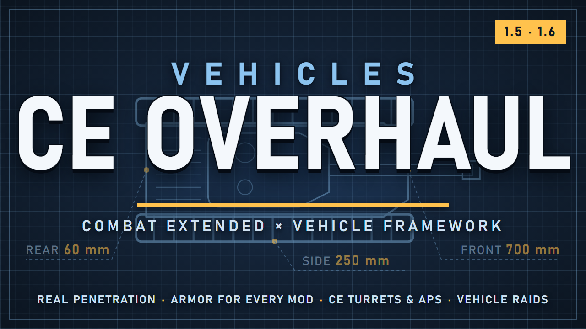

# HSK Vehicles Bridge

**English** | [Русский](#русский)

> [!CAUTION]
> **Alpha, being tested.** Things may still break. Found a problem? Open an [issue](https://github.com/Blakil/HSK-Vehicles-Bridge/issues), see Bugs below.

Vehicles for **Hardcore SK**: Vehicle Framework vehicles fight by Combat Extended rules, and Vanilla Vehicles Expanded with its addons is built into the HSK economy.

## What's inside

| Folder | Mod | Who needs it |
|---|---|---|
| `Vehicles_CE_Overhaul` | **Vehicles CE Overhaul**: the combat core. CE armor and penetration, turrets through CE, active protection, vehicle raids. Works without HSK. | everyone (also on the [Steam Workshop](https://steamcommunity.com/sharedfiles/filedetails/?id=3836521434)) |
| `HSK_Vehicles_Bridge` | **HSK Vehicles Bridge**: vehicles in the HSK economy. Parts, recipes, research, weapon modules, HSK ammo. | HSK players |

## Vehicles CE Overhaul

- **Real armor and penetration.** CE sharp and blunt penetration against every vehicle part, cell by cell through the hull: plate, what is behind it, the crew. Front, sides, rear and roof have their own plates; plates wear down; airbursts hit the roof.
- **Crew and damage.** Crews get hurt inside, exposed gunners can be shot. A vehicle is knocked out first and destroyed once its vital systems are wrecked.
- **Running gear.** A shot-off track, a dead engine or gearbox stops the vehicle; a holed fuel tank leaks.
- **Turrets through CE:** CE ammo, ballistics and aiming (gunner skill, range estimation, leading, weather, smoke), ammo menu, fire on the move, a "no friendly fire" switch.
- **Active protection (APS)** upgrade for APCs and tanks: shoots down incoming rockets.
- **Repair kits.** A colonist repairing a vehicle uses them up and works 20 times faster, in the field up to half of each part; next to a garage bench 40 times faster and all the way.
- **Vehicle raids** (optional): raiders bring combat vehicles by raid points; vehicles take firing positions, keep up with their infantry, shell walls in the way. Empty enemy vehicles can be captured. With VehicleRaid Framework or VVE Raid our raids switch off by themselves.
- **Any vehicle mod** works: vehicles without hand-made tables get armor by class and CE ammo by weapon type.

### Hand-made armor tables

- Vanilla Vehicles Expanded (+ Tier 3, Tier 3.9, Upgrades)
- XCOM Skyranger
- Titan Vehicles
- Alpha Vehicles: Age of Sail, Neolithic
- Astartes Vehicles
- GrimWorld 40,000
- RimThunder WW2 tanks

## HSK Vehicles Bridge

- **HSK economy.** Vanilla Vehicles Expanded and vehicle addons get vehicle parts, recipes and a research branch in the HSK progression, with HSK materials and prices.
- **Weapon modules.** Interchangeable weapon modules in the vehicle upgrade trees.
- **HSK ammo.** Stock vehicle turrets fire HSK ammo; vehicle armor is rescaled to HSK calibers.
- **APS** module and charges, and the repair kit, are crafted from HSK materials.
- **Garage.** The garage bench, cabinet and refueling pump are built from the metal you choose.
- **Disassembly.** Vehicle parts are taken apart on the garage bench; each piece comes back with a chance that grows with Crafting (about half for a skilled crafter).
- **VehicleRaid Framework (1.6):** a ready preset of which factions bring which vehicles, with HSK prices.

### Supported addons

Each part loads only when its addon is active. Late-game parts (ceramite plate, cogitator, fusion reactor, gravitic drive, shield emitter) appear only with an addon that uses them.

- Vanilla Vehicles Expanded – Tier 3
- Tier 3.9
- Vanilla Vehicles Expanded – Upgrades
- Tier 3 Upgrades
- Upgrades Extended
- Secondary Weapons
- Titan Vehicles (+ Titan Vehicles Upgrades)
- XCOM Skyranger
- Alpha Vehicles: Age of Sail, Neolithic
- Warhammer 40,000: Astartes Vehicles, GrimWorld 40,000. **Vehicles only:** the Astartes themselves and their crafting (added by other GrimWorld mods, not related to vehicles) are not adapted.
- Sabbat's Blight (1.5): upgrade trees only
- CaptainTesss wagons and bicycle: prices only

## Requirements

- **[Vehicles CE Overhaul](https://steamcommunity.com/sharedfiles/filedetails/?id=3836521434):** [Harmony](https://steamcommunity.com/sharedfiles/filedetails/?id=2009463077), [Vehicle Framework](https://steamcommunity.com/sharedfiles/filedetails/?id=3014915404), [Combat Extended](https://steamcommunity.com/sharedfiles/filedetails/?id=2890901044).
- **HSK Vehicles Bridge:** [Hardcore SK](https://github.com/HardcoreSK/Hardcore-SK) (GitHub), [Vehicles CE Overhaul](https://steamcommunity.com/sharedfiles/filedetails/?id=3836521434), [Vehicle Framework](https://steamcommunity.com/sharedfiles/filedetails/?id=3014915404), [Vanilla Vehicles Expanded](https://steamcommunity.com/sharedfiles/filedetails/?id=3014906877).

## Installation

1. Download: **Code → Download ZIP**.
2. Copy both folders, `Vehicles_CE_Overhaul` and `HSK_Vehicles_Bridge`, into `RimWorld/Mods`.
   On Steam you can subscribe to Vehicles CE Overhaul on the Workshop instead and copy only `HSK_Vehicles_Bridge`. Do not keep two copies of the core: the game will report a duplicate packageId.
3. Mod list: both go below HSK, Vehicle Framework and your vehicle mods, first Vehicles CE Overhaul, then HSK Vehicles Bridge. Auto-sort puts them in place.
4. Updating: delete the old folders first, then copy the new ones, so removed files do not stay behind.

Safe to add to a running game. Do not remove mid-game: some vehicles change structure (extra armor plates) and break in that save.
Settings: *Options → Mod settings → Vehicles CE Overhaul*.

## Bugs

Open an [issue](https://github.com/Blakil/HSK-Vehicles-Bridge/issues) with:
- what happened and what you expected;
- which vehicle and which vehicle mods you use;
- your log: `Player.log` from `%USERPROFILE%\AppData\LocalLow\Ludeon Studios\RimWorld by Ludeon Studios\`, uploaded to [pastebin.com](https://pastebin.com) or [gist.github.com](https://gist.github.com).

## Modders

Armor tables, turret data, APS and raid settings for your vehicles: `Vehicles_CE_Overhaul/Docs/MODDING.md`.

## Credits and license

Built on [Vehicle Framework](https://github.com/SmashPhil/Vehicle-Framework) by Smash Phil and [Combat Extended](https://github.com/CombatExtended-Continued/CombatExtended) by the CE team, for [Hardcore SK](https://github.com/HardcoreSK/Hardcore-SK) by the HSK team. Thanks to Oskar Potocki and the Vanilla Expanded team, Sarg Bjornson, the GrimWorld team and the RimThunder team. Vehicle art belongs to its authors.

License: [CC BY-NC 4.0](https://creativecommons.org/licenses/by-nc/4.0/) for these mods' own code, data and art: use, change, reupload, put in modpacks, make patches and continuations; credit Blakil as the original author; no commercial use. One part of the core's code is adapted from Vehicle Framework under the MIT License (`Vehicles_CE_Overhaul/THIRD_PARTY_NOTICES.txt`).

---

# Русский

[English](#hsk-vehicles-bridge) | **Русский**

> [!CAUTION]
> **Альфа-версия, идёт тестирование.** Что-то может ломаться. Нашли проблему? Создайте [issue](https://github.com/Blakil/HSK-Vehicles-Bridge/issues), см. раздел «Баги».

Техника для **Hardcore SK**: машины Vehicle Framework воюют по правилам Combat Extended, а Vanilla Vehicles Expanded с аддонами встроены в экономику HSK.

## Что в репозитории

| Папка | Мод | Кому нужен |
|---|---|---|
| `Vehicles_CE_Overhaul` | **Vehicles CE Overhaul**: боевое ядро. Броня и пробитие CE, башни через CE, активная защита, рейды с техникой. Работает и без HSK. | всем (есть и в [Мастерской Steam](https://steamcommunity.com/sharedfiles/filedetails/?id=3836521434)) |
| `HSK_Vehicles_Bridge` | **HSK Vehicles Bridge**: техника в экономике HSK. Детали, рецепты, исследования, оружейные модули, патроны HSK. | игрокам HSK |

## Vehicles CE Overhaul

- **Настоящая броня и пробитие.** Пробитие CE (острое и тупое) по каждой части машины, клетка за клеткой через корпус: плита, то, что за ней, экипаж. У лба, бортов, кормы и крыши свои плиты; плиты изнашиваются; подрывы в воздухе бьют в крышу.
- **Экипаж и повреждения.** Экипаж ранит внутри, открытых стрелков можно подстрелить. Машина сначала выходит из строя, а уничтожается, когда разбиты важные системы.
- **Ходовая.** Сбитая гусеница, убитый двигатель или коробка останавливают машину; пробитый бак течёт.
- **Башни через CE:** патроны, баллистика и прицеливание CE (навык стрелка, оценка дальности, упреждение, погода, дым), меню патронов, стрельба на ходу, режим «не стрелять по своим».
- **Активная защита (КАЗ)** как улучшение для БТР и танков: сбивает летящие ракеты.
- **Ремкомплекты.** Поселенец, чинящий машину, тратит их и работает в 20 раз быстрее, в поле — до половины каждой детали; у верстака гаража в 40 раз быстрее и до конца.
- **Рейды с техникой** (по желанию): налётчики приводят боевые машины по очкам рейда; машины занимают огневые позиции, держатся рядом с пехотой, расстреливают стены на пути. Пустую вражескую технику можно захватить. С VehicleRaid Framework или VVE Raid наши рейды отключаются сами.
- **Любой мод на технику** работает: машины без ручных таблиц получают броню по классу и патроны CE по типу оружия.

### Ручные таблицы брони

- Vanilla Vehicles Expanded (+ Tier 3, Tier 3.9, Upgrades)
- XCOM Skyranger
- Titan Vehicles
- Alpha Vehicles: Age of Sail, Neolithic
- Astartes Vehicles
- GrimWorld 40,000
- танки RimThunder времён Второй мировой

## HSK Vehicles Bridge

- **Экономика HSK.** Vanilla Vehicles Expanded и аддоны получают детали, рецепты и ветку исследований в прогрессии HSK, с материалами и ценами HSK.
- **Оружейные модули.** Сменные оружейные модули в деревьях улучшений техники.
- **Патроны HSK.** Штатные башни стреляют патронами HSK; броня техники пересчитана под калибры HSK.
- **КАЗ** (модуль и заряды) и ремкомплект крафтятся из материалов HSK.
- **Гараж.** Верстак гаража, шкаф и заправка строятся из металла на выбор.
- **Разборка.** Детали техники разбираются на верстаке гаража; каждая составляющая возвращается с шансом, который растёт с ремеслом (у умелого мастера около половины).
- **VehicleRaid Framework (1.6):** готовый пресет, какие фракции приводят какую технику, с ценами HSK.

### Поддерживаемые аддоны

Каждая часть грузится, только если её аддон включён. Поздние детали (керамитовая плита, когитатор, термояд, гравидвигатель, генератор поля) появляются только с аддоном, который их использует.

- Vanilla Vehicles Expanded – Tier 3
- Tier 3.9
- Vanilla Vehicles Expanded – Upgrades
- Tier 3 Upgrades
- Upgrades Extended
- Secondary Weapons
- Titan Vehicles (+ Titan Vehicles Upgrades)
- XCOM Skyranger
- Alpha Vehicles: Age of Sail, Neolithic
- Warhammer 40,000: Astartes Vehicles, GrimWorld 40,000. **Только техника:** самих астартес и их крафты (их добавляют другие моды GrimWorld, к технике они не относятся) патч не адаптирует.
- Sabbat's Blight (1.5): только деревья улучшений
- повозки и велосипед CaptainTesss: только цены

## Требования

- **[Vehicles CE Overhaul](https://steamcommunity.com/sharedfiles/filedetails/?id=3836521434):** [Harmony](https://steamcommunity.com/sharedfiles/filedetails/?id=2009463077), [Vehicle Framework](https://steamcommunity.com/sharedfiles/filedetails/?id=3014915404), [Combat Extended](https://steamcommunity.com/sharedfiles/filedetails/?id=2890901044).
- **HSK Vehicles Bridge:** [Hardcore SK](https://github.com/HardcoreSK/Hardcore-SK) (GitHub), [Vehicles CE Overhaul](https://steamcommunity.com/sharedfiles/filedetails/?id=3836521434), [Vehicle Framework](https://steamcommunity.com/sharedfiles/filedetails/?id=3014915404), [Vanilla Vehicles Expanded](https://steamcommunity.com/sharedfiles/filedetails/?id=3014906877).

## Установка

1. Скачать: **Code → Download ZIP**.
2. Скопировать обе папки, `Vehicles_CE_Overhaul` и `HSK_Vehicles_Bridge`, в `RimWorld/Mods`.
   В Steam ядро можно вместо этого взять подпиской в Мастерской и скопировать только `HSK_Vehicles_Bridge`. Две копии ядра одновременно не держите: игра пожалуется на повтор packageId.
3. Список модов: оба ниже HSK, Vehicle Framework и модов на технику, сначала Vehicles CE Overhaul, потом HSK Vehicles Bridge. Автосортировка ставит их правильно.
4. Обновление: сначала удалить старые папки, потом скопировать новые, чтобы не остались удалённые файлы.

Можно добавить в идущую игру. Не удаляйте посреди игры: у части машин меняется устройство (дополнительные бронеплиты), и в таком сейве они ломаются.
Настройки: *Настройки → Настройки модов → Vehicles CE Overhaul*.

## Баги

Создайте [issue](https://github.com/Blakil/HSK-Vehicles-Bridge/issues):
- что случилось и что ожидали;
- какая машина и какие моды на технику стоят;
- лог: `Player.log` из `%USERPROFILE%\AppData\LocalLow\Ludeon Studios\RimWorld by Ludeon Studios\`, залитый на [pastebin.com](https://pastebin.com) или [gist.github.com](https://gist.github.com).

## Мододелам

Таблицы брони, данные башен, КАЗ и настройки рейдов для своей техники: `Vehicles_CE_Overhaul/Docs/MODDING.md`.

## Благодарности и лицензия

Сделано на [Vehicle Framework](https://github.com/SmashPhil/Vehicle-Framework) от Smash Phil и [Combat Extended](https://github.com/CombatExtended-Continued/CombatExtended) от команды CE, для [Hardcore SK](https://github.com/HardcoreSK/Hardcore-SK) от команды HSK. Спасибо Oskar Potocki и команде Vanilla Expanded, Sarg Bjornson, команде GrimWorld и команде RimThunder. Графика техники принадлежит её авторам.

Лицензия: [CC BY-NC 4.0](https://creativecommons.org/licenses/by-nc/4.0/) на собственный код, данные и графику этих модов: можно использовать, менять, перезаливать, класть в сборки, делать патчи и продолжения; указывайте Blakil как автора оригинала; без коммерческого использования. Часть кода ядра адаптирована из Vehicle Framework по лицензии MIT (`Vehicles_CE_Overhaul/THIRD_PARTY_NOTICES.txt`).
